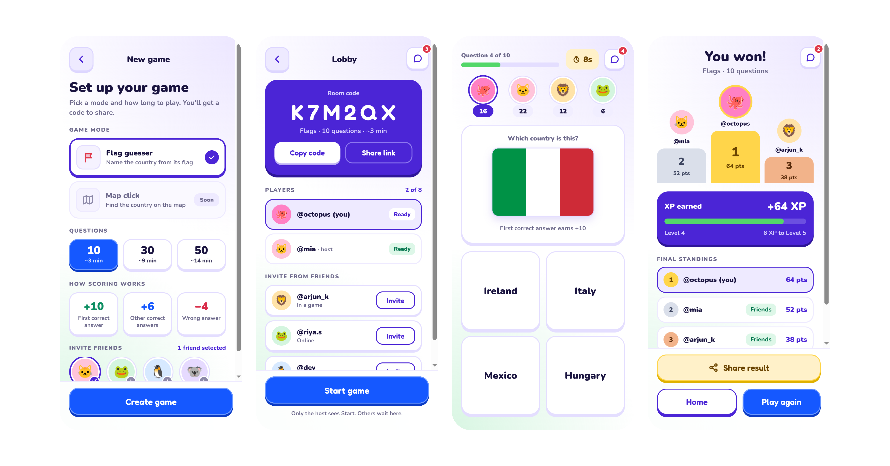
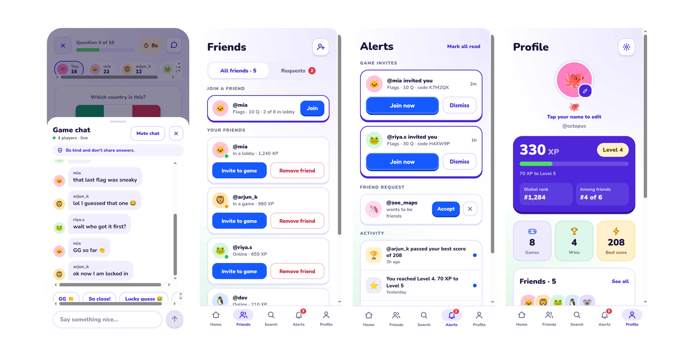
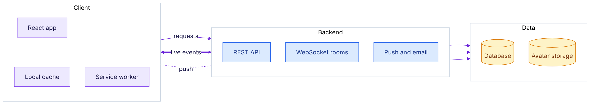
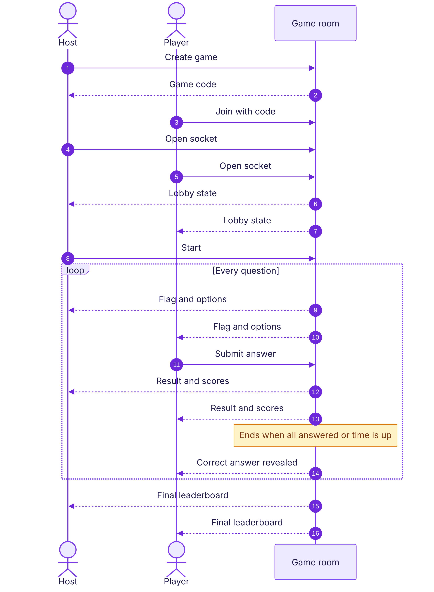
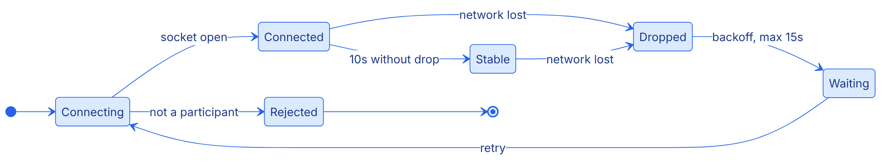
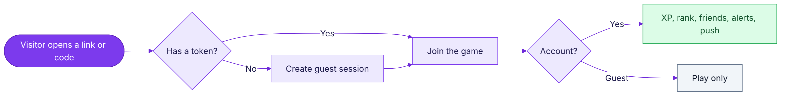
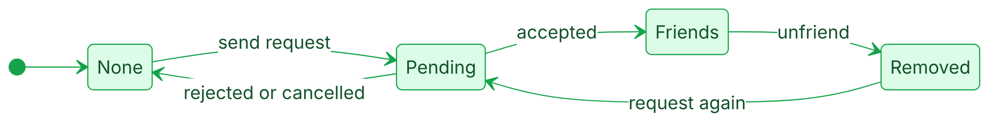
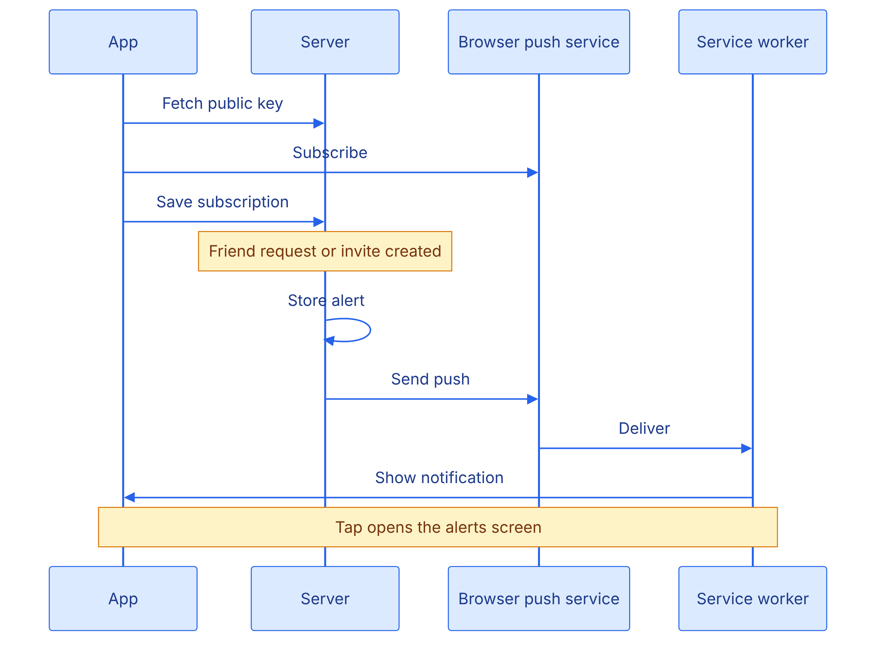
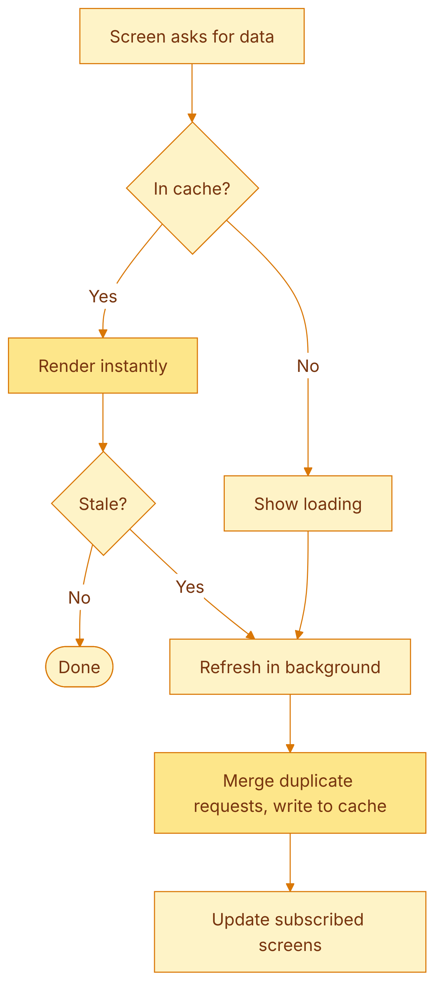
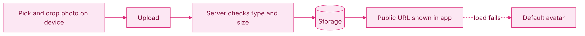

# Flagged

A real-time multiplayer flag guessing game. Create a room, share a code, race your friends. Installable as an app, with accounts, guest play, friends, leaderboards, live chat, and push notifications.

**Live:** [https://flagged-fe.vercel.app/](https://flagged-fe.vercel.app/)

> Showcase repository. This documents how Flagged is built. The source code is not included.

---

## The app

**Create a game, Lobby, Gameplay, Results**

**Chat, Friends, Alerts, Profile**

## Built with

React and Vite on the front. FastAPI on the back. WebSockets for live play. Supabase for avatar storage. Web Push for notifications. Deployed on Render.

---

## Architecture

### The big picture

REST handles everything that is a lookup or a change. The WebSocket handles everything that is live. Keeping them separate makes each one simple.

---

### A game round

The server decides everything: who the player is, whether an answer is valid, how many points it earns. Clients only send intent. The correct answer is never sent with the question, only after it closes.

---

### Staying connected

Reconnects back off exponentially. The retry counter only resets after ten stable seconds, which prevents a connect-drop loop from retrying at full speed. A player who rejoins mid-question gets the remaining time and their own answer state back from the server.

---

### Who is playing

Guests are stored as real user rows, so the game code has only one kind of player to deal with. Following a shared link takes you straight into a lobby, no signup needed.

---

### Friends and invites

Every request and invite is stored as an alert first, then optionally pushed to the device. Accepting a game invite hands back the code to join.

---

### Push notifications

The alert is saved before the push is sent, so a failed push never loses an event. Expired subscriptions are removed automatically.

---

### Keeping the UI fast

Cache keys are scoped to the signed-in token, so one account never sees another's data. Duplicate requests are merged, and refreshes pause while the tab is hidden.

---

### Avatars

Cropping happens on the device, so the server only ever stores a small square image.

---